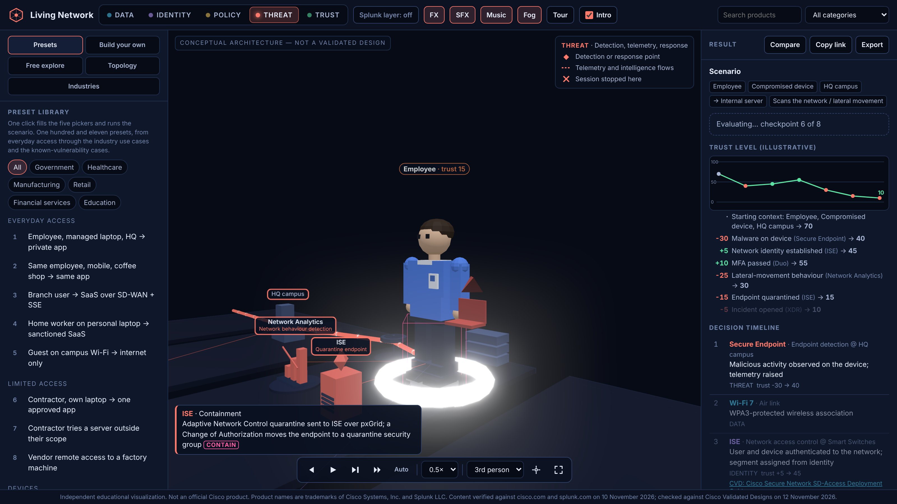
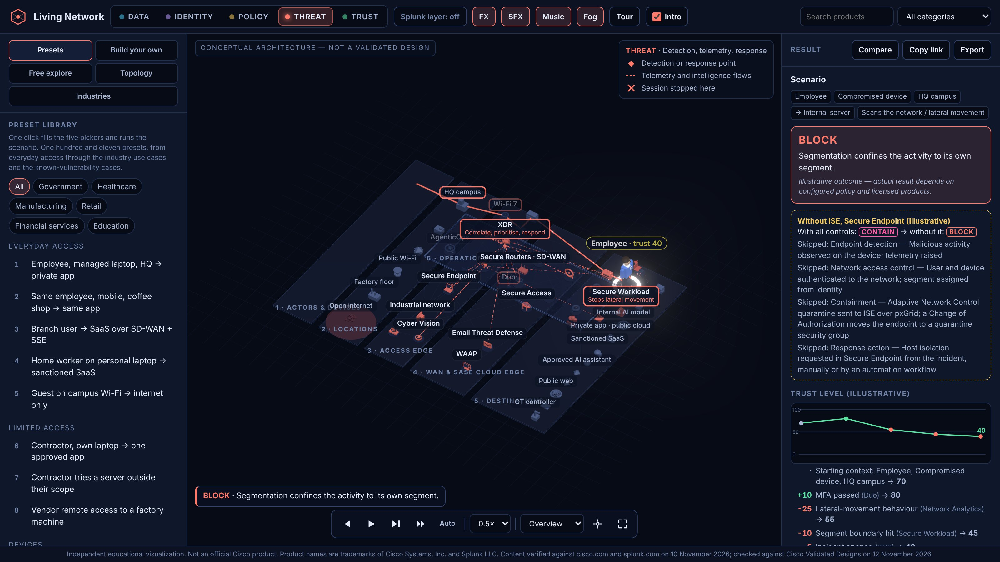
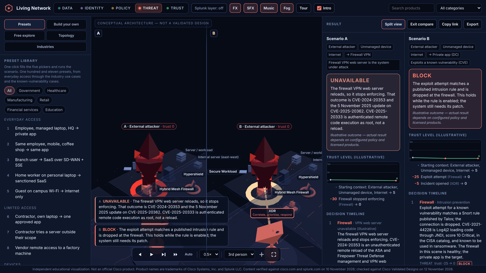
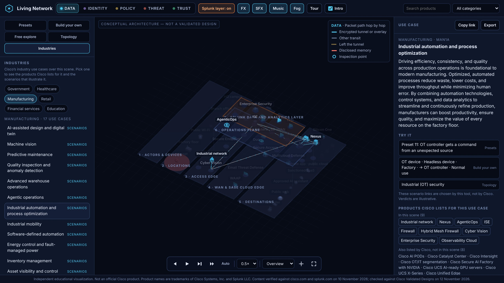

# Living Network for systems engineers: the whiteboard that answers back

*A compromised laptop scans the campus. Secure Network Analytics spots it, and ISE moves it into a quarantine group.*

Every systems engineer knows the moment. The architecture slide is up, the customer is nodding, and then someone asks:

"OK, but what actually happens when a contractor tries to reach the finance server?"

You pick up the marker. You draw an arrow. You say "and then ISE…" and hope nobody asks about the bit after that.

Living Network is built for that moment. You set up the question, press play, and the scene answers it one hop at a time. Every checkpoint is named. Every claim links to a public Cisco page.

The [first post](https://darsh.im/blog/living-network-watching-zero-trust-decide-one-hop-at-a-time) covered what the tool does. The [second](https://darsh.im/blog/living-network-105-industry-use-cases-each-with-a-scenario-you-can-play) added 105 industry use cases. This one is about who it is for, and what a systems engineer gets out of it on an ordinary Tuesday.

**[Open Living Network →](https://darsh.im/p/living-network-conceptual-architecture-explainer)**

## What changed since last time

- **111 presets.** Seven follow attacker techniques from Cisco Talos reporting in 2026, such as a phishing proxy that steals a session, or a fake help-desk call that ends in a remote-control session. Twelve more follow known vulnerabilities, each named by its CVE.
- **Two new verdicts.** CONTROL LOST means nothing stopped the traffic and a control you were counting on no longer applies. UNAVAILABLE means the service went down. Not every story ends in a satisfying BLOCK, and the tool now says so.
- **Checked against Cisco Validated Designs.** Product panels, topology views and individual checkpoints now link the Cisco design guide or reference that backs them. There are 34 of them, including a 254-page industrial security guide I read so you don't have to.
- **An intro card** before each scenario says who is asking, from where, and which checkpoints are coming. It never gives away the ending.

## Who it is for

- **Systems engineers**, at Cisco or at a partner. The rest of this post is for you.
- **Account managers** who want to tell the security story without the 40-slide deck.
- **Customer architects and security leads** who want to test an idea before the design workshop.
- **SOC teams** who want to see where detection and response fit, including the Splunk layer.
- **OT engineers** who want to see the plant floor, not just the office.
- **Anyone new to Cisco security**: new hires, students, people changing roles. It is a lot more fun than a product matrix.

## Eight ways it helps a systems engineer

**1. Discovery, before you have a design.** Open **Industries**, pick the customer's industry and the use case they care about. The products Cisco lists for it stay lit and the rest of the scene fades. The panel shows Cisco's own drivers and benefits, and a **Try it** block gives you a scenario to run. Your prep goes from an hour of slide hunting to two clicks.

**2. Replace the whiteboard.** Press play. A figure walks the path, each product says what it checked and what it found, and a trust level rises and falls. Switch lenses to see the same session as data, identity, policy, threat or trust. The customer watches decisions instead of boxes.

**3. Answer "do we really need that?" honestly.** Open **Without these controls**, remove a product and replay. Here is a good one. Take ISE out of the compromised-laptop scenario and it is *still* contained: Secure Workload blocks the flow and XDR isolates the host through Secure Endpoint. Now take Secure Endpoint out too. The verdict drops from CONTAIN to BLOCK. The flow is stopped, but nobody contains the laptop.

*Without ISE and Secure Endpoint, segmentation still blocks the flow. Nothing contains the laptop any more.*

That is defense in depth on one screen, and you didn't have to say "defense in depth" once.

**4. Back up every claim.** Click any product. You get what it does, what it works with, and a source link for every relationship: cisco.com, splunk.com, Splunkbase, or a Cisco Validated Design. When a customer asks "where does it say that?", you have the page. If I couldn't find a public statement, the line isn't drawn.

**5. Talk about this year's attacks, not 2019's.** The 2026 presets come from Talos reporting. Preset 33 loads with Secure Endpoint already removed, because the ransomware crew in the report uninstalled it first. Secure Access still blocks the data theft and ISE still quarantines the host. The known-vulnerability presets name the CVE and show its effect, including the uncomfortable ones where the security device itself is the target.

**6. Compare two worlds side by side.** **Compare** runs two scenarios in a split view. Preset 100 puts them next to each other: on the left the firewall's own VPN web server is the target and reloads (UNAVAILABLE). On the right, the same firewall drops an exploit aimed at the app behind it (BLOCK). Same box, two very different days. Great for the "why patching still matters" conversation.

*Preset 100 in split view: the firewall is the victim on the left and the defender on the right.*

**7. Leave something behind.** **Copy link** opens the exact scenario for the customer later. **Export** saves a printable PDF report with the scene, the decision timeline and the sources, or an image, Markdown or JSON. Your follow-up email writes itself. Well, half of it.

**8. Ramp yourself up.** New to Hybrid Mesh Firewall, or to the Splunk side? **Topology** lays out 14 architectures as diagrams, with numbered relationships, their sources and the design guides behind them. The guided tour walks the whole tool in twelve steps. **Build your own** lets you poke at combinations until the rules make sense.

*Industries: a manufacturing use case lights up the products Cisco lists for it, with a scenario to try.*

## A ten-minute demo you can steal

1. **Minute 0.** Preset 1: an employee on a managed laptop at HQ opens a private app. ALLOW. Boring on purpose.
2. **Minute 2.** Under "Change one thing", switch to an unmanaged personal device. Duo spots it and the verdict becomes ALLOW WITH LIMITS.
3. **Minute 4.** Preset 22: a compromised laptop scans the campus. Secure Network Analytics spots it, ISE quarantines it, XDR opens an incident. CONTAIN.
4. **Minute 6.** Remove ISE and replay. Still contained. Remove Secure Endpoint too. Now it is only blocked. Let the room sit with that.
5. **Minute 8.** Open Industries, pick the customer's industry and one use case, and run its Try it scenario.
6. **Minute 10.** Copy link, paste it into the follow-up email. Done. Coffee.

## What it is not

- **Not a design tool.** There is no sizing, no bill of materials and no licensing view.
- **Not a promise.** Verdicts show a typical zero-trust outcome, not guaranteed product behaviour. The page says so beside every result.
- **Not a real score.** The 0 to 100 trust level is a teaching device. No product shows that number.
- **Not official.** It is an independent project, and it uses no Cisco artwork.

So next time someone asks "what actually happens if…", leave the marker in the tray. Press play.

**[Open Living Network →](https://darsh.im/p/living-network-conceptual-architecture-explainer)**

---

*Independent educational project. Not an official Cisco product. Product names are trademarks of their owners.*
