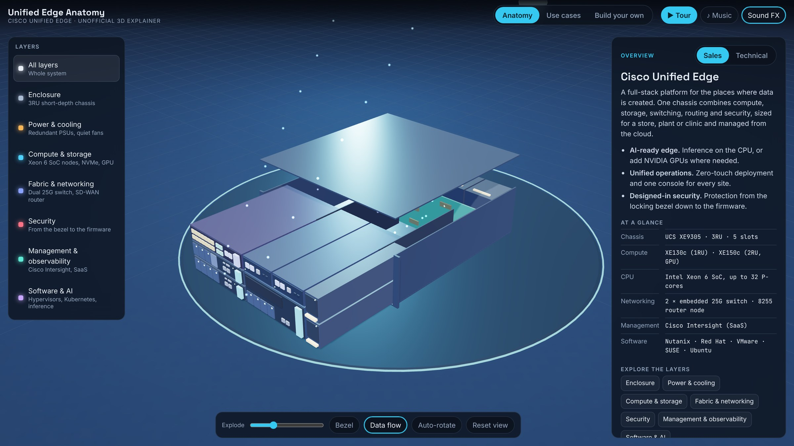
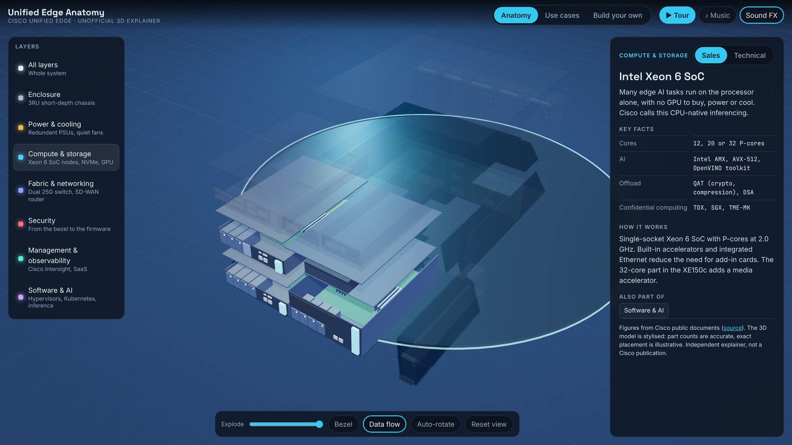
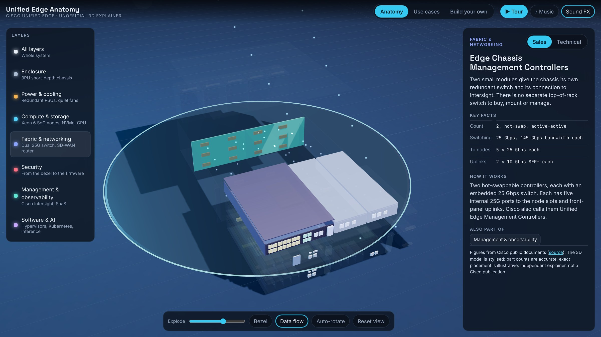
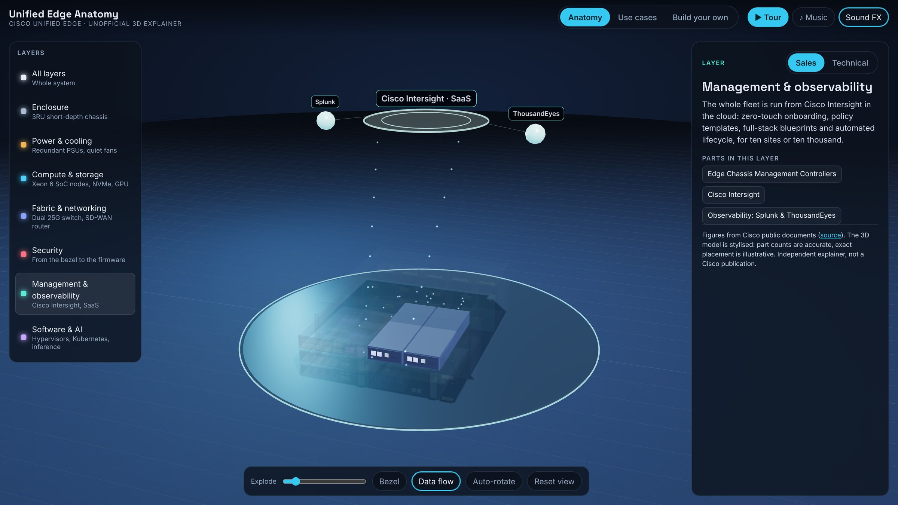
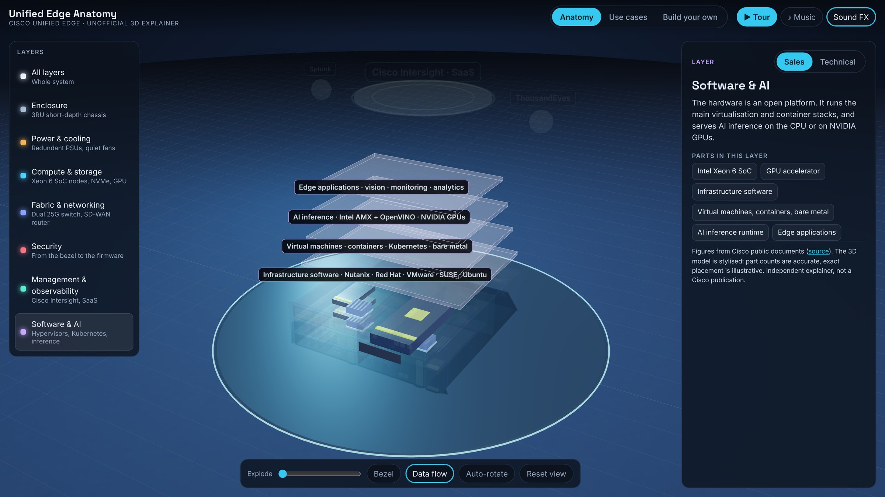
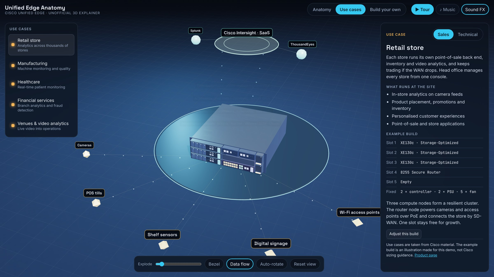
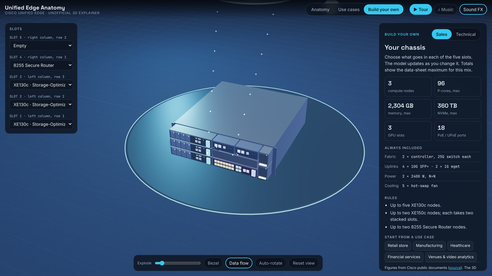

# Taking Cisco Unified Edge Apart in 3D

Every time I explain Cisco Unified Edge, I end up drawing the same boxes on a whiteboard. A chassis here, some nodes there, a line up to the cloud. So I built something better: an interactive 3D model you can open in a browser, pull apart, and click through.

**[Open the interactive demo →](https://darsh.im/p/unified-edge-anatomy)**

This post walks through what the demo shows and, along the way, what Unified Edge actually is.

## What is Cisco Unified Edge?

Cisco describes it as a full-stack platform for the edge. In practice it is one 3RU chassis that combines compute, storage, switching, routing and security, built for places that are not data centres: a store back room, a factory floor, a hospital wing, a bank branch.

Three ideas run through Cisco's material:

- **AI-ready edge.** Inference runs where the data is created, on the CPU or on NVIDIA GPUs.
- **Unified operations.** Every site is deployed and managed from Cisco Intersight in the cloud.
- **Designed-in security.** Protection starts at the locking bezel and goes down to the firmware.

## The anatomy, layer by layer

The demo splits the system into seven layers. Select one and the rest of the model fades, so you see only the parts that belong to it.

### 1. Enclosure

The chassis is the Cisco UCS XE9305. It is 3RU high and 18 inches deep, which is short enough for a shallow rack. It also mounts on a wall or a shelf. Five front-facing slots take sled-style nodes that swap without tools.

### 2. Power and cooling

Two 2400 W power supplies run in N+N redundancy and are serviced from the front. Five hot-swap fan modules cool the system, with acoustic control so it can sit near people.

### 3. Compute and storage

This is where the explode slider earns its place. Slide it to the right and the nodes come out of the chassis and open up.

There are two compute nodes:

| | XE130c M8 | XE150c M8 |
|---|---|---|
| Size | 1RU, half-width | 2RU, half-width |
| Per chassis | Up to 5 | Up to 2 |
| CPU | Intel Xeon 6 SoC, 12 / 20 / 32 P-cores | Intel Xeon 6 SoC, 20 / 32 P-cores |
| Memory | Up to 768 GB DDR5 | Up to 1,024 GB DDR5 |
| NVMe | Up to 4 × E3.S, 30 TB each | Up to 4 × E3.S, 30 TB each |
| GPU | One 75 W card, such as NVIDIA L4 | One full-size card, such as L40S or RTX PRO 6000 Blackwell SE |

Both nodes boot from a mirrored pair of M.2 drives, so every front bay stays free for data.

One point worth making to customers: many edge AI tasks do not need a GPU at all. The Xeon 6 SoC includes Intel AMX, and Cisco calls this CPU-native inferencing.

### 4. Fabric and networking

There are no cables between the servers and the switch. Each node plugs into a midplane that carries two 25 Gbps links, one to each of two Edge Chassis Management Controllers. Each controller has an embedded 25G switch and two 10G SFP+ uplinks. The two work as one active-active fabric.

You can also put networking in a slot. The Cisco 8255 Secure Router node adds SD-WAN, fourteen 1G PoE ports and four multigigabit UPoE ports, so cameras, phones and access points get power and data from the same chassis.

### 5. Security

Edge sites rarely have a locked cage or on-site staff. The demo shows the layers of protection: a locking bezel with intrusion detection, TPM 2.0 and signed firmware in each node, and zero-trust management from the cloud.

### 6. Management and observability

Cisco Intersight runs the fleet as a SaaS service. A chassis ships to a site, someone plugs it in, and it configures itself from a blueprint. Cisco's phrase is "ten systems or ten thousand". Splunk and ThousandEyes add logs, metrics and network path visibility.

### 7. Software and AI

The hardware is an open platform. Cisco names Nutanix, Red Hat, VMware and SUSE as supported infrastructure software, and publishes validated designs for Red Hat OpenShift, Nutanix NKP and Canonical Ubuntu. Virtual machines, containers and bare-metal workloads can run side by side.

## What can you build with it?

The Use cases tab loads five scenarios taken from Cisco's material:

- **Retail:** in-store analytics, inventory and point-of-sale that keeps working if the WAN drops.
- **Manufacturing:** machine monitoring, predictive maintenance and vision-based quality checks.
- **Healthcare:** real-time patient monitoring with data kept on site.
- **Financial services:** fraud detection and branch analytics.
- **Venues:** live video turned into queue and crowd analytics.

Each one shows an example build and the site devices that feed it. The example builds are my own illustrations, not Cisco sizing guidance.

## Build your own

The last tab is a configurator. Pick what goes in each of the five slots and the model rebuilds itself. Running totals show the maximum cores, memory, NVMe capacity, GPU slots and PoE ports for your mix. Cisco's limits are enforced: up to five XE130c, up to two XE150c, up to two router nodes.

## How to use the demo

- Drag to orbit, scroll or pinch to zoom, and click any part for details.
- Switch between **Sales** and **Technical** in the details panel. Sales leads with the value; Technical leads with the full spec table.
- Press **Tour** for a guided walk-through with captions.
- Turn on **Music** and **Sound FX** if you are presenting.

## A note on accuracy

This is an independent explainer, not a Cisco publication. Part counts and specifications come from Cisco's public data sheets, FAQ and at-a-glance documents. The 3D model is stylised, so exact placement inside the chassis is illustrative. For anything you plan to quote or order, check the sources below.

## Sources

- [Cisco Unified Edge product page](https://www.cisco.com/site/us/en/products/computing/unified-edge/index.html)
- [Cisco UCS XE9305 chassis data sheet](https://www.cisco.com/site/us/en/products/collateral/computing/unified-edge/cisco-ucs-xe9305-chassis-ds.html)
- [Cisco UCS XE130c M8 data sheet](https://www.cisco.com/site/us/en/products/collateral/computing/unified-edge/ucs-xe130c-m8-compute-node-ds.html)
- [Cisco UCS XE150c M8 data sheet](https://www.cisco.com/site/us/en/products/collateral/computing/unified-edge/ucs-xe150c-m8-compute-node-ds.html)
- [Cisco Unified Edge FAQ](https://www.cisco.com/c/en/us/products/collateral/servers-unified-computing/unified-edge/unified-edge-faq.html)
- [Cisco Unified Edge At-a-Glance](https://www.cisco.com/c/en/us/products/collateral/servers-unified-computing/unified-edge/unified-edge-at-a-glance.html)
- [Cisco Unified Edge for Red Hat Edge design guide](https://www.cisco.com/c/en/us/td/docs/unified_computing/ucs/UCS_CVDs/cisco_ucs_edge_red_hat_design.html)
- [Cisco Unified Edge and Nutanix NKP design guide](https://www.cisco.com/c/en/us/td/docs/unified_computing/ucs/UCS_CVDs/cisco_unified_edge_nutanix_nkp_ubuntu_design.html)
- [Cisco Unified Edge and Canonical Ubuntu design guide](https://www.cisco.com/c/en/us/td/docs/unified_computing/ucs/UCS_CVDs/Cisco_Unified_Edge_and_Canonical_Ubuntu_for_Edge_Deployments_Design.html)
